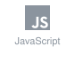
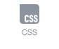
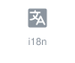

# Hi, I'm Amanda Palma 👋

Frontend developer based in Madrid with 4+ years of frontend experience, the last 3 at StubHub building React interfaces for a ticketing platform. Before moving into code, I spent over a decade in cultural production and management (festivals, performing arts, audiovisual projects). I'm also a musician and have a graphic design background, which helps me work closely with designers and understand the product side.

## 🛠 What I work with

              

## 💼 Experience
- **StubHub** (2022–2025) · Frontend developer, Post-Purchase team: Help & Contact Center, order details and MyAccount features for multiple country sites. React, Redux, i18n, Jest, React Testing Library.
- **Sopra Steria** (2021–2022) · Frontend developer on a French real estate group's project. React, Material UI, SonarQube.
- **Capgemini** (2020–2021) · Frontend developer in agile teams. JavaScript, React, Git.

## 🌱 What I'm doing now
- Studying the [Lemoncode Frontend Master](https://lemoncode.net/cursos/master-front-end.html) to strengthen my fundamentals, including TypeScript.
- Open to frontend roles (Madrid or remote).

Most of my professional code is private, so this profile shows personal and learning projects.

## 📫 Find me

&nbsp;&nbsp;&nbsp;

